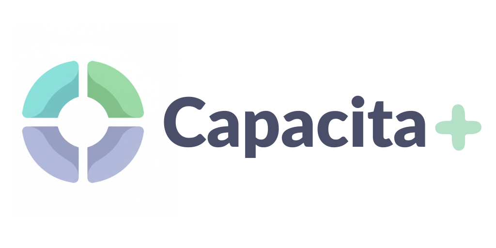
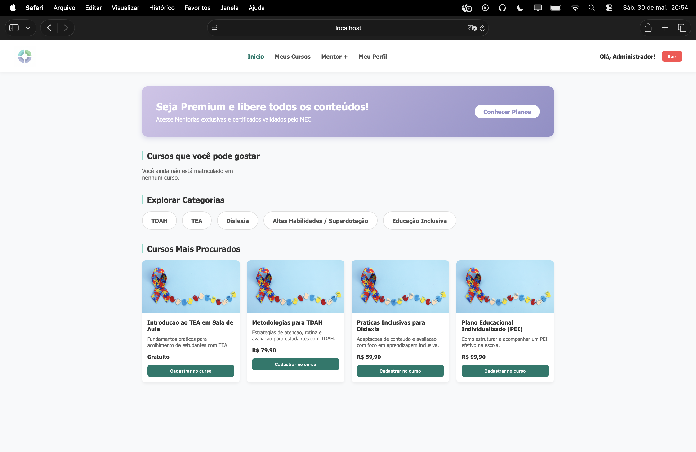
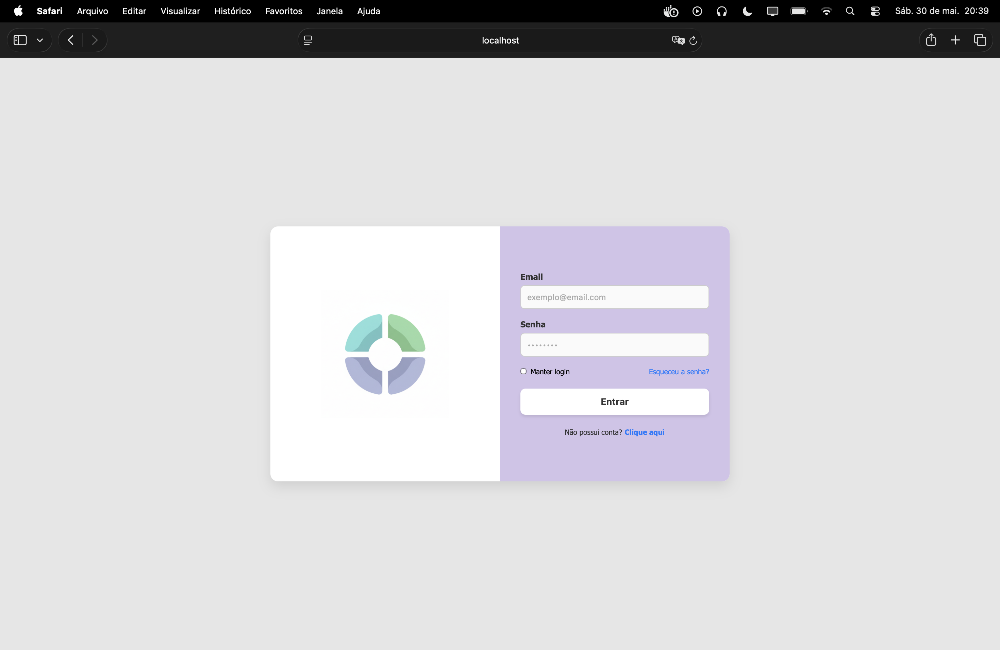
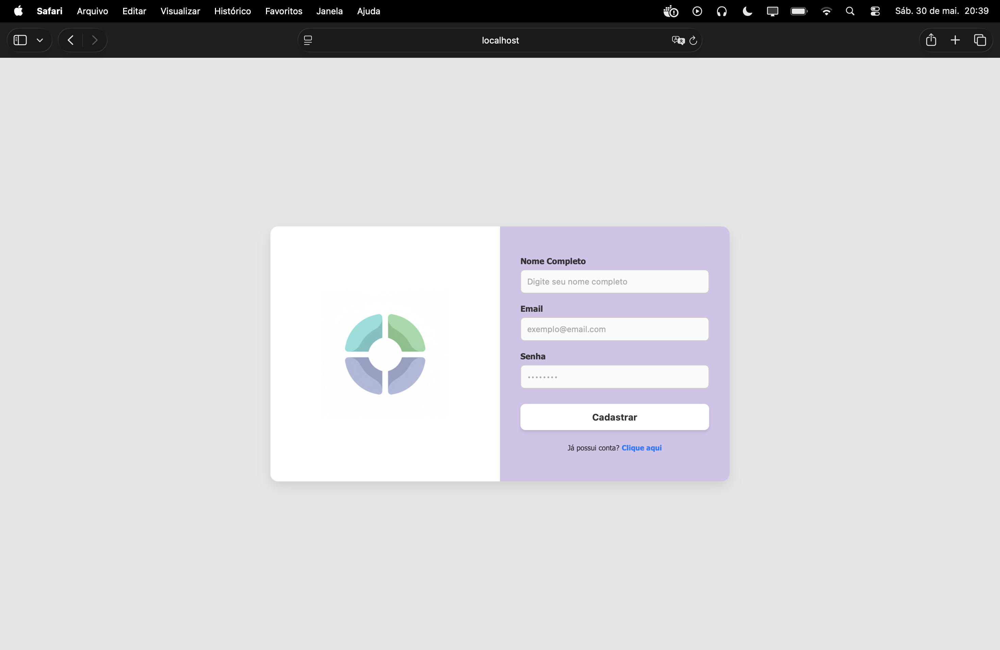
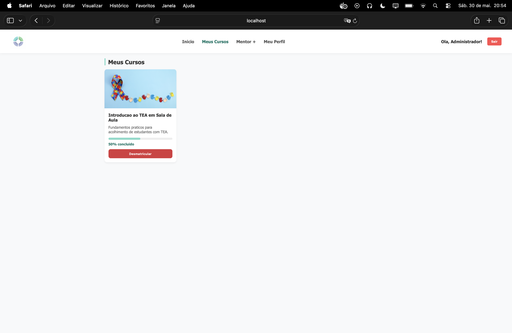
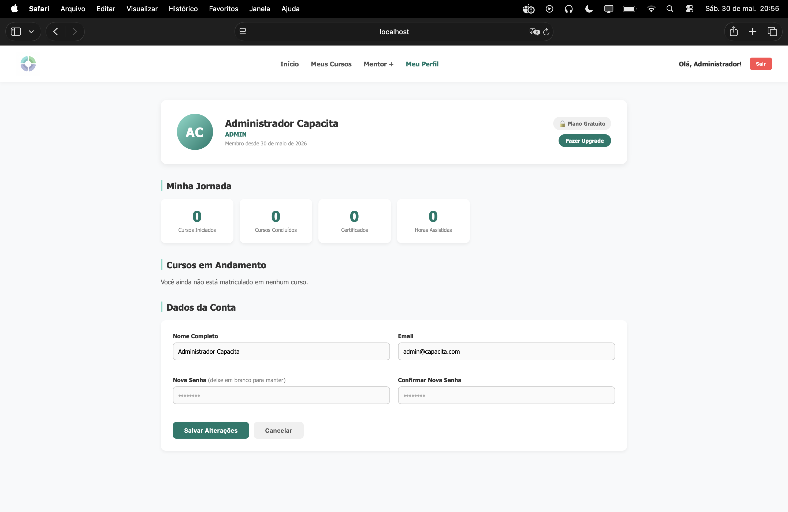
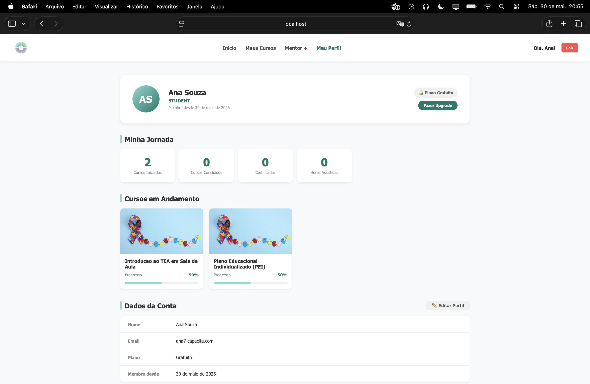
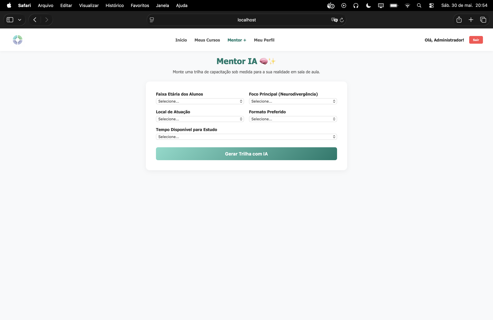

<h1 align="center"> Capacita + <br>
</h1>

### O Capacita+ é uma plataforma educacional inclusiva, projetada especificamente para apoiar alunos neurodivergentes (TEA, TDA, TDAH, entre outros). Nosso objetivo é romper barreiras no aprendizado através de um ensino personalizado, fornecendo as ferramentas necessárias para que cada estudante desenvolva seu potencial máximo e construa um futuro com mais autonomia e oportunidades

<h2 align="center"> ⛏️💻 Stacks e Tecnologias Utilizadas: </h2>
<p align="center">
<br>


<br>


</p>

<h2 align="center">🖥️ Plataformas Disponíveis:</h2>
<p align="center">


</p>

<h2 align="center"> 🏛️ Arquitetura Geral do Projeto: </h2>
<pre>
Capacita-Mais/
├── BackEnd/
├── FrontEnd/
├── img/
├── docker-compose.yml
├── package-lock.json
├── LICENSE
└── README.md
</pre>


<h2 align="left"> Frontending </h2>
<pre>
├── README.md
└── Capacita-Front/
    ├── node_modules/
    ├── public /
    ├── src/
    │   ├── assets /
    │   ├── components /
    │   ├── hooks /
    │   ├── pages /
    │   ├── App.css 
    │   ├── App.jsx 
    │   ├── index.css 
    │   └── main.jsx 
    ├── .gitignore 
    ├── eslint.config.js 
    ├── index.html 
    ├── package-lock.json 
    ├── package.json 
    ├── README.md 
    └── vite.config.js 
</pre>

<h2 align="left">  Backending</h2>

<pre>
├── README.md
└── capacita-back-end/
    ├── prisma /
    ├── src /
    ├── test /
    ├── .gitignore 
    ├── .prettierrc 
    ├── docker-compose.yml 
    ├── eslint.config.mjs 
    ├── nest-cli.json 
    ├── openapi.yaml 
    ├── package-lock.json 
    ├── package.json 
    ├── prisma.config.ts 
    ├── README.md 
    ├── tsconfig.build.json 
    └── tsconfig.json 
</pre>


<h2 align="center">📂 Modularização SCM (Service, Module & Controller)<br>


</h2>

###  `.controller.ts`

Camada de **entrada da API**. Recebe as requisições HTTP e define as rotas (`@Get`, `@Post`, `@Put`, `@Delete`). Não contém lógica de negócio — apenas delega ao Service. É aqui que decorators de documentação e metadados de rota são aplicados.

**Arquivos neste projeto:** `app.controller.ts` `auth.controller.ts` `courses.controller.ts` `enrollments.controller.ts` `users.controller.ts`

###  `.service.ts`

Camada de **lógica de negócio**. Processa os dados recebidos do Controller, aplica as regras da aplicação (validações, hash de senha com `bcrypt`, geração de JWT) e comunica com o banco via Prisma. Injetado no Controller via `@Injectable()`.

**Arquivos neste projeto:** `app.service.ts` `auth.service.ts` `courses.service.ts` `enrollments.service.ts` `prisma.service.ts` `users.service.ts`

###  `.module.ts`

**Unidade de organização** do NestJS. Agrupa e registra o Controller e o Service de um domínio (`imports`, `providers`, `controllers`, `exports`). Permite que outros módulos reutilizem os providers via <b>`exports`</b>. O `AppModule` é o módulo raiz que importa todos os demais.

**Arquivos neste projeto:** `app.module.ts` `auth.module.ts` `courses.module.ts` `enrollments.module.ts` `prisma.module.ts` `users.module.ts`

<h2 align="center">Telas 📱 <br>


</h2>

<table align="center" width="780">
  <tr><th align="center">🏠 Tela Inicial</th></tr>
  <tr><td align="center"><b>Página de entrada da plataforma Capacita+ — o estudante acessa os cursos disponíveis, visualiza seu progresso e navega pelos módulos de aprendizado personalizados.</b></td></tr>
  <tr><td align="center"></td></tr>
</table>

<br>

<table align="center" width="780">
  <tr><th align="center">🔐 Login — Acesso à Plataforma</th></tr>
  <tr><td align="center"><b>Telas de autenticação segura da plataforma. O usuário insere suas credenciais (e-mail e senha) para acessar o ambiente personalizado de aprendizado inclusivo.</b></td></tr>
  <tr><td><table width="100%"><tr>
    <td align="center"></td>
    <td align="center"></td>
  </tr><tr>
    <td align="center"><b>Tela de entrada com e-mail e senha</b></td>
    <td align="center"><b>Confirmação e redirecionamento de perfil</b></td>
  </tr></table></td></tr>
</table>

<br>

<table align="center" width="780">
  <tr><th align="center">📚 Meus Cursos</th></tr>
  <tr><td align="center"><b>Painel do estudante com todos os cursos em andamento e disponíveis — exibe progresso individual por módulo, trilhas de aprendizado adaptadas e acesso rápido ao próximo conteúdo.</b></td></tr>
  <tr><td align="center"></td></tr>
</table>

<br>

<table align="center" width="780">
  <tr><th align="center">👤 Perfis de Usuário</th></tr>
  <tr><td align="center"><b>A plataforma possui dois perfis distintos: o <strong>Administrador</strong>, que gerencia cursos, usuários e conteúdos; e o <strong>Estudante</strong>, que visualiza seu progresso, histórico e dados pessoais.</b></td></tr>
  <tr><td><table width="100%"><tr>
    <td align="center"></td>
    <td align="center"></td>
  </tr><tr>
    <td align="center"><b>⚙️ Perfil Administrador — gestão de usuários e cursos</b></td>
    <td align="center"><b>🎓 Perfil Estudante — progresso e histórico de aprendizado</b></td>
  </tr></table></td></tr>
</table>

<br>

<table align="center" width="780">
  <tr><th align="center">🤖 IA Integrada</th></tr>
  <tr><td align="center"><b>Assistente inteligente embutido na plataforma — oferece suporte personalizado ao estudante com respostas adaptadas ao seu perfil de aprendizado, ajudando a superar dificuldades com conteúdos específicos em tempo real.</b></td></tr>
  <tr><td align="center"></td></tr>
</table>


<h2 align="center"> 👤👩‍🏫 Docente Responsável: </h2>
<ul>
  <li><strong>Aêda Monalliza Cunha de Sousa</strong> <a href="https://www.linkedin.com/in/aedasousa/" target="_blank"></a></li>
</ul>

<h2 align="center"> 👥 Integrantes do Projeto: </h2>
<ul>
  <li><strong>Victor José Paes (Líder 👑)</strong> <a href="https://www.linkedin.com/in/viictorpaes/" target="_blank"></a> <a href="https://github.com/viictorpaes" target="_blank"></a></li>
  <li>Cauã Henrique de Melo Almeida <a href="https://www.linkedin.com/in/caua-henrique-melo-almeida-b83744380/" target="_blank"></a></li>
  <li>Eduardo de Souza Cavalcanti Junior <a href="https://www.linkedin.com/in/eduardoscavalcantij/" target="_blank"></a> <a href="https://github.com/eduardo-scavalcanti" target="_blank"></a></li>
  <li>Felipe Franca Alves de Lima <a href="https://www.linkedin.com/in/felipefrancaal/" target="_blank"></a> <a href="https://github.com/ffrancaal" target="_blank"></a></li>
  <li>Helamã Leone de Lima Procídio <a href="https://www.linkedin.com/in/helam%C3%A3-procidio-428772367/" target="_blank"></a> <a href="https://github.com/procidiohelama-star" target="_blank"></a></li>
  <li>João Pedro Arruda Guimarães <a href="https://www.linkedin.com/in/jo%C3%A3o-pedro-arruda-guimar%C3%A3es-157952287/" target="_blank"></a> <a href="https://github.com/Jp230603" target="_blank"></a></li>
  <li>Lucas Moreira de Carvalho</li>
  <li>Lucas Paguetti Pereira <a href="https://www.linkedin.com/in/lucas-paguetti-pereira" target="_blank"></a> <a href="https://github.com/wqiluc" target="_blank"></a></li>
  <li>Maria Eduarda Vasconcelos da Silva <a href="https://www.linkedin.com/in/maria-eduarda-vasconcelos-5877401b7/" target="_blank"></a> <a href="https://github.com/mariavsvasconcelos-maker" target="_blank"></a></li>
  <li>Mateus Henrique Diniz da Silva</li>
  <li>Pablo Tamborini Nogueira <a href="https://www.linkedin.com/in/pablo-tamborini-nogueira/" target="_blank"></a></li>
  <li>Tiago Luiz Moreira de Vasconcelos <a href="https://www.linkedin.com/in/tiagoluiz23/" target="_blank"></a> <a href="https://github.com/2006tiagoluiz" target="_blank"></a></li>
  <li>Victor Barros Roma <a href="https://www.linkedin.com/in/victor-roma-38035a111/" target="_blank"></a> <a href="https://github.com/RomaNFS21" target="_blank"></a></li>
</ul>

<h2 align="center"> 🕹️ Comandos para inicializar o projeto: <br>
</h2>

### Siga os passos abaixo para configurar o ambiente e executar a aplicação localmente em sua máquina:

###
<ul>
  <li>
   <br>
    <code>Ctrl</code> + <code>j</code> (tecla de crase)
  </li> <br>
  <li>
     <br>
    <code>Ctrl</code> + <code>j</code> (tecla de crase)
  </li> <br>
  <li>
     <br>
    <code>Command</code> + <code>j</code> (tecla de crase)
  </li>
</ul>

<br>

Após baixar o Github desktop: <br>


<h3 align="center">Rodar localmente <br>

</h3>

```bash
# Clone o repositório:
git clone https://github.com/viictorpaes/Capacita-Mais

# Acesse a pasta raiz do projeto:
cd Capacita-Mais

# Suba todos os serviços (banco, migrations, seed, backend e frontend):
docker compose up -d
```

```bash
# Acesse o frontend em:
http://localhost:5173/

# Acesse a API em:
http://localhost:3000/api
```

```bash
# (Opcional) Visualize o banco de dados pelo Prisma Studio:
cd BackEnd/capacita-back-end
npx prisma studio

# Para parar todos os serviços:
docker compose down
```

<h2 align="center"> 🔑 Versões mínimas para rodar o projeto: </h2>

<div style="display: flex; flex-wrap: wrap; justify-content: center; align-items: center; gap: 10px; width: 100%;">
  
  
  
  
  
  
  
  
  
  
  
  
  
  
</div>


<h2 align="center"> License <br>
</h2>

```license
MIT License

Copyright (c) 2026, Capacita+

Permission is hereby granted, free of charge, to any person obtaining a copy
of this software and associated documentation files (the "Software"), to deal
in the Software without restriction, including without limitation the rights
to use, copy, modify, merge, publish, distribute, sublicense, and/or sell
copies of the Software, and to permit persons to whom the Software is
furnished to do so, subject to the following conditions:

The above copyright notice and this permission notice shall be included in all
copies or substantial portions of the Software.

THE SOFTWARE IS PROVIDED "AS IS", WITHOUT WARRANTY OF ANY KIND, EXPRESS OR
IMPLIED, INCLUDING BUT NOT LIMITED TO THE WARRANTIES OF MERCHANTABILITY,
FITNESS FOR A PARTICULAR PURPOSE AND NONINFRINGEMENT. IN NO EVENT SHALL THE
AUTHORS OR COPYRIGHT HOLDERS BE LIABLE FOR ANY CLAIM, DAMAGES OR OTHER
LIABILITY, WHETHER IN AN ACTION OF CONTRACT, TORT OR OTHERWISE, ARISING FROM,
OUT OF OR IN CONNECTION WITH THE SOFTWARE OR THE USE OR OTHER DEALINGS IN THE
SOFTWARE.
```